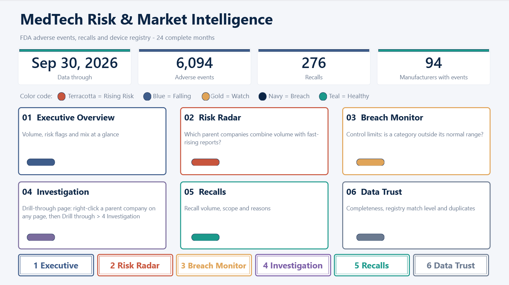
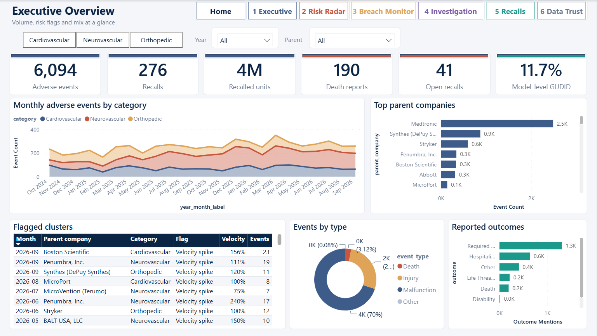
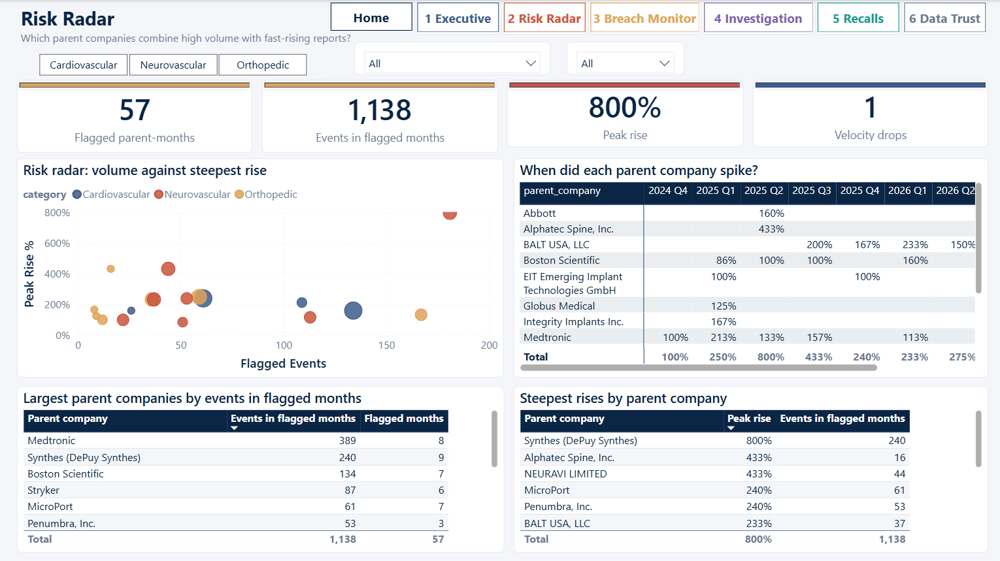
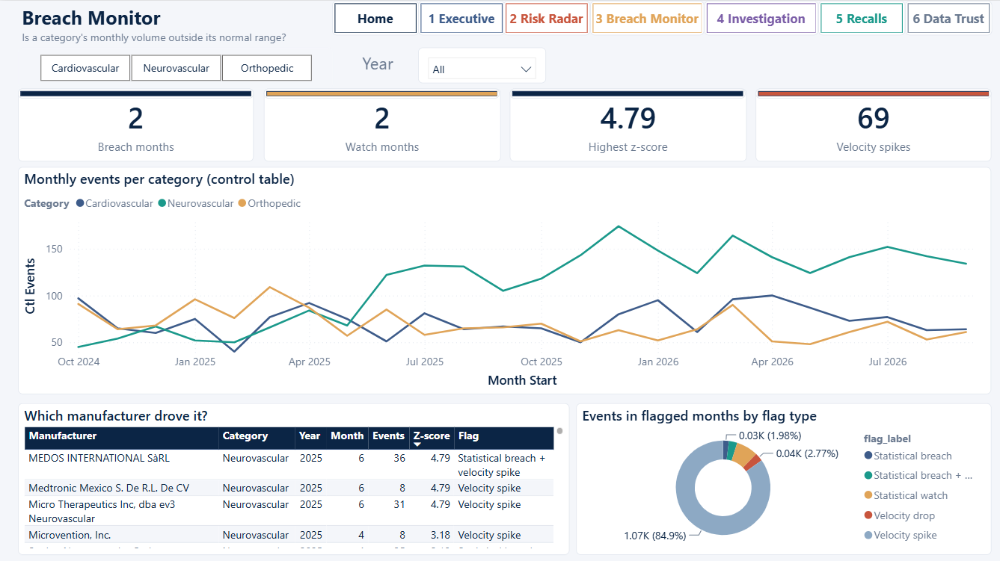
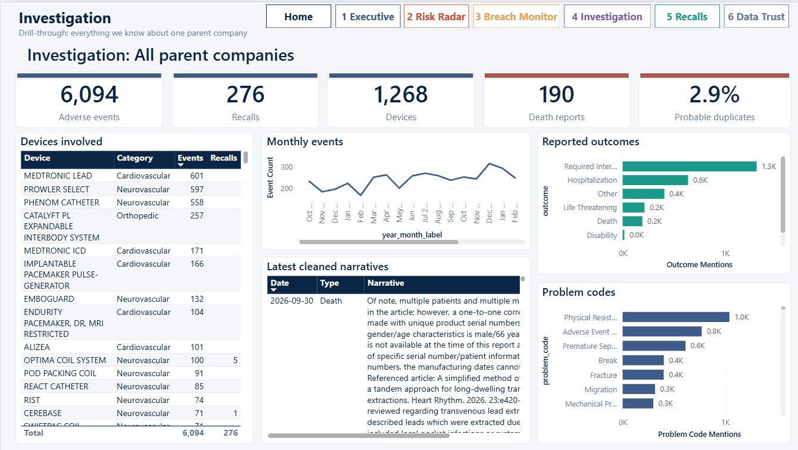
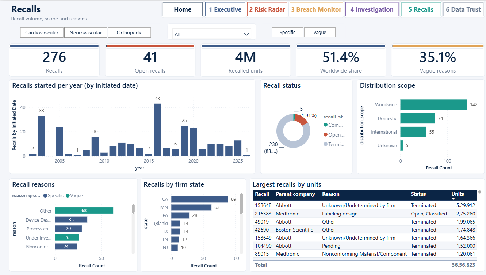
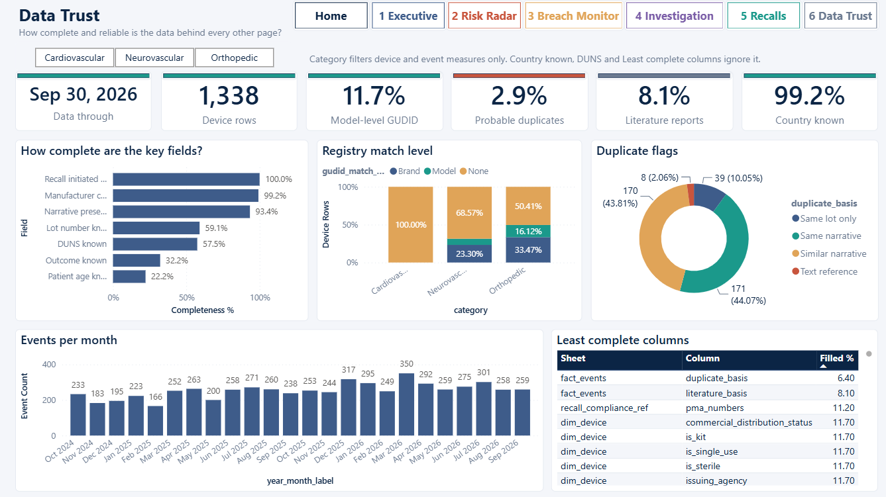

# MedTech Risk & Market Intelligence pipeline

Turns public FDA data into a validated Excel workbook for Power BI: adverse-event reports (MAUDE), recalls, the device registry (GUDID) and
device classification for five product codes, with monthly risk flags per category, manufacturer and parent company.

```
openFDA API
   |
   v
 BRONZE   raw JSON, exactly as downloaded                      data/bronze/*.json
   |
   v
 SILVER   cleaned, typed, de-duplicated, manufacturers merged   data/silver/*.parquet
   |
   v
 GOLD     SQLite star schema + the two risk-flag tables         data/gold/medtech_warehouse.db
   |
   v
 EXPORT   PowerBI_Export.xlsx (14 sheets) + quality gate        data/gold/PowerBI_Export.xlsx
```

## Report preview

The Power BI report has a home page and six report pages, shown below.

**Home**



**Executive Overview**



**Risk Radar**



**Breach Monitor**



**Investigation**



**Recalls**



**Data Trust**



## Quick start

```bash
pip install -r requirements.txt
python tests/unit_tests.py           # checks without network - must end with "ALL ... CHECKS PASSED"
python run_pipeline.py               # full run; the last stage is the quality gate
```

An openFDA API key is optional; without one, the pipeline uses public access at a lower request rate. To configure a key, copy `.env.example` to `.env`
(PowerShell: `Copy-Item .env.example .env`) and set `OPENFDA_API_KEY`. Get a free key at <https://open.fda.gov/apis/authentication/>.
`.env` and other environment files are git-ignored: never commit a key. Every log line is filtered so `api_key=...` is written as `api_key=***`, and
the validator scans the log for a leaked key.

## Commands

| Command | What it does |
|---|---|
| `python run_pipeline.py` | download -> Silver -> Gold -> Excel -> validate |
| `python run_pipeline.py --from silver` (or `python resume_pipeline.py`) | re-clean the already downloaded Bronze files, then everything after |
| `python run_pipeline.py --from gold` (or `python resume_pipeline.py --from gold`) | rebuild the warehouse and the workbook from the existing Silver files |
| `python run_pipeline.py --status` | what each layer currently holds |
| `python validate_export.py [file.xlsx] [--log pipeline.log] [--json out.json]` | run the quality gate on any export |

In VS Code open `run_pipeline.py` in the project root and press Run. (Do not run the files inside `medtech/` directly: they are a package and are started by the root scripts.)
`python -m medtech ...` does the same as the root scripts if you prefer it.

`run_pipeline.py` and `validate_export.py` exit with **0** (clean), **1** (a HIGH finding) or **2** (a CRITICAL finding), so a scheduler or CI job can stop on a bad export.
Gold is deleted and rebuilt on every run that includes the Gold load. Bronze is append-only: every downloaded file is read, so delete `data/bronze/`
to start from a fresh download.

## Outputs

| File | Layer | Notes |
|---|---|---|
| `data/gold/PowerBI_Export.xlsx` | export | the file Power BI imports: 10 fact / dimension / reference sheets, `root_cause_flags`, `root_cause_flags_parent`, `data_coverage`, `field_guide` |
| `data/gold/recall_code_info_full.csv` | export | the complete text of recall `code_info` values longer than 32,000 characters. Excel cannot hold more, so the workbook keeps a cut copy flagged in `code_info_is_truncated` |
| `data/gold/medtech_warehouse.db` | gold | SQLite warehouse; the two flag tables are stored here and the workbook reads them from here |
| `data/_logs/pipeline.log` | - | latest run only; the previous ten are archived in `data/_logs/archive/` |

## Reviewed reference data

Edit these files, not the code. See [`config/README.md`](config/README.md).

| File | Purpose |
|---|---|
| `parent_company_map.csv` | manufacturer -> parent company (first matching rule wins). Starter rules: have a domain expert review them |
| `manufacturer_country_overrides.csv` | country for firms the lookups cannot find (the log lists the firms still unknown) |
| `brand_name_overrides.csv` | brand-name typos for `dim_device.brand_name_display` |
| `device_description_map.csv` | descriptions to map to the FDA device name (regex + optional product codes) |

## Project layout

```
run_pipeline.py  resume_pipeline.py  validate_export.py      the commands you run (project root)
medtech/
  pipeline.py  __main__.py        the ordered stages; alternative command line (python -m medtech)
  common.py                       paths, logging with secret redaction, openFDA client
  text_normalize.py  country_normalize.py  reference_data.py     shared helpers
  bronze/   ingest_maude  ingest_recalls  ingest_gudid  ingest_classification
  silver/   quality_checks  narrative_clean
  gold/     load_gold  enrich_manufacturer_country  root_cause
  export/   export_to_powerbi  validate_export
config/     reviewed reference data           sql/schema.sql   warehouse schema
tests/      unit_tests.py  offline_fixture.py
docs/       CHANGELOG.md  ISSUE_LOG.md
```

## Testing without network access

```bash
export MEDTECH_OFFLINE=1             # Windows: set MEDTECH_OFFLINE=1  (skips the openFDA registry lookups)
python tests/offline_fixture.py      # synthetic Bronze data covering every data-quality case the pipeline handles
python run_pipeline.py --from silver
```

The fixture replaces the contents of `data/bronze/`, so it refuses to run when that folder holds real downloaded files. Use a fresh clone.

## Data-quality notes and known limits

- `date_key` in `fact_events` is the FDA **receipt** date, not the date the event happened.
- Only the first device and the first patient of each MAUDE report are used.
- GUDID coverage depends on the registry; the validator reports model-level coverage as a MEDIUM finding. That is a source limit, not a defect.
- Lost-character repair in narratives is rule-based; patterns that cannot be decided are left alone and counted in the log.
- The MAUDE country field is a 2-letter code. The pipeline detects whether the data uses FIPS or ISO from the codes that exist in only one standard,
  and never guesses a code it cannot decide.
- Duplicate reports are flagged (`is_probable_duplicate`, `is_possible_duplicate`), never removed.

Change history: [`docs/CHANGELOG.md`](docs/CHANGELOG.md). Resolved issues: [`docs/ISSUE_LOG.md`](docs/ISSUE_LOG.md).

## License

This project is released under the MIT License. See the LICENSE file for details.
